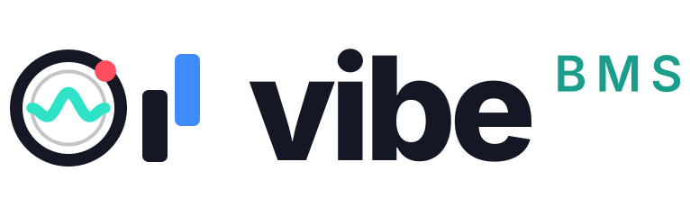

<p align="center">
  <picture>
    <source media="(prefers-color-scheme: dark)" srcset="assets/logo/logo-dark.svg">
    
  </picture>
</p>

A cross-platform BMS player modelled on Lunatic Rave 2 and beatoraja.
Written in Rust with wgpu and cpal, it runs on Windows, macOS and Linux (x64/ARM) and in web browsers (wasm),
and has an on-screen controller for touch devices such as iPads and Android tablets.

The *vibe* in the name means two things: the vibe of the music in a rhythm game, and that this project was made
by **vibe coding**. Nearly all of the code and the default skins were written in conversation with an AI coding
agent (Claude Code); a person set the direction and checked the results by playing.

- No launcher: it starts at song select, and every setting is changed in the game.
- Settings, scores and caches live in a folder next to the executable (portable).
- BMS folders inside the executable's folder are scanned automatically; other folders can be added.

> Status: early development (0.1). Tested on the desktop (Linux) and in browsers; the Android and iOS builds have
> not been tried on real devices yet.

## Quick start

Builds of the latest commit, for every platform, are on the
[Nightly](https://github.com/vibeBMS/vibe/releases/tag/nightly) prerelease: the executables, the Android `.apk` and
the unsigned iOS `.ipa` as they are, the web build as a zip. Or build it yourself:

```sh
cargo run --release                                  # song select
cargo run --release -- path/to/song.bme --autoplay   # play a chart directly
```

Put a release build of the executable in a folder and put your BMS folders inside it. Folders elsewhere can be
dropped on the window or added in `SETTINGS › LIBRARY`. Building for each platform: [docs/BUILDING.md](docs/BUILDING.md).

```text
<root>/config/config.toml      settings (edited in the game; editing by hand works too)
<root>/scores/scores.json      play records
<root>/cache/                  song scan and difficulty table caches (made again if deleted)
<root>/skins/                  LR2 / beatoraja skins
<root>/fonts/*.ttf|otf|ttc     fonts to use (optional)
```

If the executable's folder cannot be written to, the user data folder is used; `VIBEBMS_ROOT` sets the location.

## Controls

| | Keyboard defaults (as beatoraja) |
|---|---|
| 1P 7 keys | `Z S X D C F V`, scratch `LShift` / `LCtrl` |
| 2P 7 keys | `M K , L . ; /`, scratch `RShift` / `RCtrl` |
| 9 keys (PMS) | `A S D F G H J K L` |
| Song select | ↑↓ move; Enter, → or a white key: decide (open a folder, play a song); ← or a blue key: close the folder; Backspace / Esc back; `/` search; F2–F9 options; F12 rescan; P watch the chart's replay |
| Play | ↑↓ hi-speed, PgUp/PgDn SUDDEN+, ←→ judge offset, Esc quit |
| Song select, holding START (`Q`) / SELECT (`W`) | play option panels (beatoraja's key layout). START: 1▼2▲ RANDOM, 3 GAUGE, 4 DP OPTION, 5 HS-FIX, 6▲7▼ 2P RANDOM, turntable TARGET. SELECT: 1 EXPAND JUDGE, 2 CONSTANT, 3 JUDGE AREA, 4 LEGACY NOTE, 5 MARK NOTE, 6 BPM GUIDE, 7 NO MINE. Both (or number key 5): 1 BGA, 2 GAUGE AUTO SHIFT, 3 judge timing auto-adjust, 4·6 green number −/+ (repeats while held), 5·7 judge timing −/+. Number key 3: LN mode |
| Play, START (`Q`) / SELECT (`W`) | beatoraja's in-play panel: START + white key hi-speed −0.25, blue key +0.25; START + turntable lane cover (LIFT without a cover); START twice toggles the cover; SELECT + keys / turntable hi-speed ±0.01; START + SELECT for a second quits |
| Results | R / F5 retry, P watch this play again |
| Anywhere | F1 / Tab settings, F11 full screen |

Entering a folder puts the cursor on the folder's own row; deciding on it closes the folder (as in LR2).

- beatoraja's assist options: EXPAND JUDGE (wider windows; PG/GR/GD ratios in the settings), JUDGE AREA (the judge
  windows drawn above the judge line), MARK NOTE (notes hit early stay grey down to the judge line), BPM GUIDE (BPM
  changes and stops shown), judge timing auto-adjust. As in beatoraja, EXPAND JUDGE over 100% makes the play
  ASSIST EASY and BPM GUIDE on a chart whose BPM changes LIGHT ASSIST EASY; their records are not saved.
- Hi-speed: you set the multiplier (in steps of 0.25); the green number (how long notes are visible) follows from it,
  the BPM and the lane cover. HS-FIX (START BPM / MAX BPM / MAIN BPM / MIN BPM) does the opposite: the green number
  stays and the multiplier follows each chart's BPM.
- Controllers (IIDX controllers included) are set in `SETTINGS › KEY CONFIG` by pressing their buttons. Analog
  turntables work.
- Touch (`SETTINGS › TOUCH`): a BM layout (turntable and two rows of keys; round pop'n buttons for PMS), a single row
  of keys, or your own: the layout editor (`KEY CONFIG › Touch controller layout`) moves and resizes the buttons (drag
  them, drag their corners or pinch them) for each key mode and orientation, flips a layout left to right (the
  turntable changes sides; custom layouts are otherwise used as placed, whatever the play side), and sets the height of
  the controls (drag their top edge). Portrait or landscape SP and landscape DP, multi-touch and sliding. A touch
  between keys plays the nearest one. Keys are sized like an arcade's (the screen size is guessed from the device and
  can be set), and the START / SELECT buttons in the letterbox beside the play screen (on the turntable's side: a
  custom layout's turntable, else left for 1P and DP, right for 2P; or the side chosen) open the panels above. A key whose release the browser never delivers
  (an iPad's home bar dragged with a key held) is let go once no finger is on the screen.

## Features

- **Charts**: BMS/BME/BML/PMS and BMSON. `#RANDOM`/`#SWITCH` control flow, BPM changes, STOP and `#SCROLL`, LN
  (`#LNTYPE`/`#LNOBJ`/`#LNMODE`), mines, 5/7/10/14/9 keys; Shift_JIS, EUC-KR and UTF-8 detected.
- **Judging**: beatoraja / LR2 / IIDX presets and custom windows. Rules and sources: [docs/RULES.md](docs/RULES.md).
- **Gauges**: ASSIST EASY to HAZARD, dan gauges, GAUGE AUTO SHIFT.
- **Notes**: LN / CN / HCN, back-spin scratch, mines, empty POOR (空POOR).
- **Options**: MIRROR, (R/S/H-)RANDOM, SPIRAL, ALL-SCR, RANDOM+, DP FLIP, BATTLE, assists, floating / fixed hi-speed,
  SUDDEN+ / HIDDEN+ / LIFT. BATTLE, mines removed, custom judging and plays in a course leave no record for the song,
  and assisted plays are not sent to IR.
- **BGA**: image BGA (layers, POOR), video BGA (desktop, with an installed `ffmpeg`; `VIBEBMS_FFMPEG` sets its path).
- **Dan / courses**, clear lamps, EX score, FAST/SLOW, gauge and timing graphs, target score (personal best,
  rank A–AAA, MAX- / MAX).
- **Difficulty tables**: bmstable format. The insane and normal tables, Satellite and Stella are there from the
  start. Charts a table lists that are not installed show dimmed; choosing one downloads its song and its separate
  chart (差分) in the app (a manbow work page is read for its download links; Google Drive, Dropbox, MediaFire, MEGA
  and plain archive servers work; the web build goes through the vibeBMS proxy). When the song is in the library
  already, only the chart is fetched, and a message says when none of its links works.
  Links that cannot be downloaded directly (OneDrive, uploaders, deleted files) open their download page: on the
  desktop in a browser window in the app, whose downloaded zip/7z/rar/lzh is unpacked into `bms/` before the chart's page
  opens; a downloaded chart goes into its song's folder (the folder with the same title and artist that holds every
  sound it needs; when unsure, the app asks). Downloads are kept in `downloads/`. Android and iOS use the in-app
  browser too (over the game screen); the web build opens the system browser.
- **Third-party mirrors** (`SETTINGS › TABLES`, off by default): other people's copies of dead uploaders and sites
  (darksabun.club, bms.hexlataia.xyz) and the community archive (bms.kyouko.moe). What is found there by name only
  goes into the library if it holds the chart wanted (by its MD5).
- **Event mirror**: the BOF events of [vibeBMS/BMS](https://github.com/vibeBMS/BMS) (BOF22 to BOF2004) show as
  folders in song select. For events mirrored as they were (BOF22, BOF21, BOF:TT, BOF:XVII, BOF:XVI), a work not
  installed is downloaded from the mirror and unpacked into `bms/<event>/`; for the others the app downloads from
  the authors' links (Google Drive files and folders, Dropbox files and folders, MediaFire, MEGA, servers that send
  the archive). A link that needs a person on its page (OneDrive, uploaders), or that gives a page instead of an
  archive, opens that page. The web build works the same way: these hosts and GitHub's releases send no CORS
  headers, so it downloads through the vibeBMS proxy `proxy.vibebms.workers.dev`, which passes on archives only,
  and unpacks them in memory (zip, 7z, rar). Other event lists or indexes can be added in the settings
  (`archives`).
- **Replays and ghosts**: every play of your own (not a course stage, not autoplay) keeps a replay: what drove the
  judge (inputs and the times it was advanced to) with the seed and play options that made the chart, so watching
  it judges exactly the same. Each chart keeps its latest play's and its best EX score's (`scores/replays/`; in the
  web build, in the browser). Watch one with P on the results (that play) or in song select (the chart's best,
  else its latest); a replay is not recorded. With TARGET MY BEST, the pacemaker is the best play's ghost: its EX
  score at the same note, not the best score spread evenly over the chart.
- **IR**: rankings and score submission over a JSON protocol ([docs/IR_PROTOCOL.md](docs/IR_PROTOCOL.md)).
- **Audio**: low-latency output (ASIO/JACK feature flags), keysounds scheduled to the sample, WAV/OGG/MP3/FLAC.

## Skins

Play, song select and results are all drawn by skins, chosen in `SETTINGS › DISPLAY`.

- **Built-in default skins**: landscape and portrait layouts for every mode, original art drawn from shapes and
  the Inter font by `tools/gen_default_skins.py`. Edit the script and run it to make
  `crates/vibebms/assets/builtin/skins/default/` again.
- **LR2 skins** (`.lr2skin`): put them under `skins/` (`LR2files\Theme\…` paths are taken from `skins/`). Images,
  numbers, text, `#LR2FONT`, gauges, notes, judgements, bar graphs, sliders, buttons, panels, the song list, result
  graphs, `#CUSTOMOPTION`/`#CUSTOMFILE`, DxLib `.dxa` archives.
- **beatoraja skins**: JSON (`.json`) and Lua (`.luaskin`, embedded Lua 5.4 in a sandbox; not in the web build).
  `main_state`, `timer_util`, `event_util` and `skin_config` are provided, and conditions, timers, values and
  events given in Lua are evaluated every frame. Graphs (`gaugegraph`, `judgegraph`, `bpmgraph`,
  `timingdistributiongraph`, the timing visualizer) and blend modes are supported.
- **Skin downloads**: vibeBMS bundles no third-party skins. `SETTINGS › SKINS` lists the skins in
  [`skins/catalog.json`](skins/catalog.json) (read from this repository, the copy compiled in until then) and
  downloads, unpacks and installs one into `skins/` from its author's own link (Google Drive, Dropbox, MEGA, GitHub,
  plain servers), replaces it with a newer version, or deletes it. Each entry names its author, scenes, resolution,
  homepage and the terms its author states. The web build keeps them in the browser's storage, but cannot run Lua
  skins and does not unpack skins over 400 MB.
- A skin's custom options and offsets appear under it in `SETTINGS › DISPLAY`.
- vibeBMS extensions for skins: song select option text `9000+i` (value) and `9100+i` (name) and click events
  `9000+i`; result events 9500 (retry), 9501 (continue) and 9502 (watch the replay); song select events 9900
  (parent folder) and 9901 (watch the chart's replay). A graph with
  `"style": "vibebms"` is drawn as the built-in skins draw it. START / SELECT during play turn on timers 21 (panel
  open) and 31 (closed), and slider / graph value 9400 is the hi-speed position (0.5–10.0). For skins with no object
  using timer 21, the app draws a hi-speed panel beside the lanes.

## Web version

Build it with `tools/build_web.sh` and serve `web/` over HTTP. The page's buttons take a folder, files or song pack
`.zip`s (for iPad Safari), which are scanned and played in the browser; nothing is uploaded anywhere. Settings and
records are kept in localStorage.

- Songs are kept in the browser (its Origin Private File System) and are there again the next time the page opens.
  `SETTINGS › LIBRARY` shows how much room they take of what the browser allows, asks the browser to keep them for
  good, lists the song folders by size with a delete for each, and deletes those not played for 30 days or all of
  them; in song select, Delete removes the chosen song's folder (each delete asks for a second press). Add the page to
  the home screen: it runs full screen, and Safari, which may clear a site's storage after 7 days without a visit,
  keeps it.
- CI publishes a web build to the `gh-pages` branch on every push (the default branch at the site's root, other
  branches under `preview/<branch>/`). Turn on GitHub Pages (Settings › Pages › `gh-pages` / root) to open it.
  The repository variable `WEB_THIRD_PARTY=1` turns the third-party mirrors on by default in that build.
- A separate chart added on its own (📦) goes into its song's folder: the folder with the same title and artist that
  holds every sound it needs. When that cannot be decided, the page asks which song it is for.
- Browsers have no system fonts for the page, so CI puts Noto Sans CJK (JP/KR, SIL OFL) into `web/fonts/`. When
  building yourself, add CJK fonts there and list them in `fonts.txt`.
- Difficulty table servers do not allow CORS, so the web build reads tables (page, header, data) through the vibeBMS
  proxy (`proxy.vibebms.workers.dev`) each time; tables you add work the same way. IR works when its server allows
  CORS.

## Layout

```text
crates/vibebms-core     parsing, timing, judging, gauges, scores (no platform dependencies)
crates/vibebms-audio    decoders and mixer
crates/vibebms-ir       IR client
crates/vibebms          the app (winit + wgpu, skins, scenes)
crates/vibebms-web      web entry point
crates/vibebms-android  Android entry point
```

Difficulty tables, song downloads, unpacking and placing separate charts come from
[BMSeeker](https://github.com/vibeBMS/BMSeeker) (a library and a CLI).

## Not implemented yet

Adapters for particular IR services (such as MochaIR).

## License

`MIT OR Apache-2.0` (LICENSE-MIT, LICENSE-APACHE). The embedded Inter font is SIL OFL 1.1
(`crates/vibebms/assets/fonts/OFL.txt`). The logo's letters (`assets/logo/`, made by `tools/gen_logo.py`) are Inter
converted to outlines. Downloaded `.rar` files are unpacked with
[unrar-rs](https://github.com/scryer-media/rarpar/tree/main/crates/unrar-rs) (Apache-2.0, with the UnRAR license
restriction); its RAR engine is based on the UnRAR source, whose terms are:

> UnRAR source code may be used in any software to handle RAR archives without limitations free of charge, but cannot be used to develop RAR (WinRAR) compatible archiver and to re-create RAR compression algorithm, which is proprietary. Distribution of modified UnRAR source code in separate form or as a part of other software is permitted, provided that full text of this paragraph, starting from "UnRAR source code" words, is included in license, or in documentation if license is not available, and in source code comments of resulting package.

The judging and gauge rules were implemented independently, with beatoraja's public source and the judge windows
the LR2 community has published as references. No charts or music are included.
