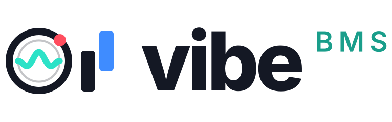

<p align="center">
  <picture>
    <source media="(prefers-color-scheme: dark)" srcset="assets/logo/logo-dark.svg">
    
  </picture>
</p>

Lunatic Rave 2 / beatoraja를 레퍼런스로 한 크로스플랫폼 BMS 플레이어입니다.
Rust + wgpu + cpal로 작성되어 Windows·macOS·Linux(x64/ARM)와 웹 브라우저(wasm)에서 동작하고,
iPad·Android 같은 터치 기기용 화면 컨트롤러를 내장하고 있습니다.

이름의 *vibe*는 두 가지 뜻입니다. 리듬게임으로서 음악의 바이브, 그리고 이 프로젝트가 **바이브코딩**으로 만들어졌다는 것.
코드와 기본 스킨은 거의 전부 AI 코딩 에이전트(Claude Code)와 대화하며 작성했고, 사람은 방향을 정하고 실제로 플레이하며 확인했습니다.

- 별도 설정창 없이 바로 선곡 화면으로 들어가며, 모든 설정은 게임 안에서 바꿉니다.
- 설정·기록·캐시는 실행 파일 옆 폴더에 저장됩니다(포터블).
- 실행 파일이 있는 폴더 안의 BMS는 자동으로 스캔되고, 다른 폴더도 추가할 수 있습니다.

> 상태: 초기 개발 버전(0.1). 데스크톱(Linux)과 브라우저에서 동작을 확인했고, Android/iOS 빌드는 실기기 검증 전입니다.

## 빠른 시작

```sh
cargo run --release                                  # 선곡 화면
cargo run --release -- path/to/song.bme --autoplay   # 차트 바로 플레이
python3 tools/gen_demo.py bms/demo                   # 테스트용 데모 차트 생성
```

릴리스 빌드한 실행 파일을 원하는 폴더에 두고 그 안에 BMS 폴더를 넣으면 됩니다.
다른 위치의 폴더는 창에 드래그 앤 드롭하거나 `SETTINGS › LIBRARY`에서 추가합니다.
플랫폼별 빌드는 [docs/BUILDING.md](docs/BUILDING.md)를 보세요.

```text
<root>/config/config.toml      설정 (게임 안에서 편집, 직접 편집도 가능)
<root>/scores/scores.json      플레이 기록
<root>/cache/                  곡 스캔·난이도표 캐시 (지워도 재생성)
<root>/skins/                  LR2 / beatoraja 스킨
<root>/fonts/*.ttf|otf|ttc     폰트 지정 (선택)
```

실행 폴더에 쓸 수 없으면 사용자 데이터 폴더를 쓰며, `VIBEBMS_ROOT`로 위치를 지정할 수 있습니다.

## 조작

| | 키보드 기본값 (beatoraja와 동일) |
|---|---|
| 1P 7키 | `Z S X D C F V`, 스크래치 `LShift` / `LCtrl` |
| 2P 7키 | `M K , L . ; /`, 스크래치 `RShift` / `RCtrl` |
| 9키(PMS) | `A S D F G H J K L` |
| 선곡 | ↑↓ 이동, Enter 결정, Backspace 뒤로, `/` 검색, F2~F9 옵션, F12 재스캔 |
| 플레이 | ↑↓ 하이스피드, PgUp/PgDn SUDDEN+, ←→ 판정 오프셋, Esc 종료 |
| 공통 | F1/Tab 설정, F11 전체화면 |

- 컨트롤러(IIDX 전용 컨트롤러 포함)는 `SETTINGS › KEY CONFIG`에서 버튼을 눌러 등록합니다. 아날로그 턴테이블도 지원합니다.
- 터치 모드(`SETTINGS › TOUCH`): IIDX 배열(턴테이블 + 2단 건반) 또는 한 줄 건반, 세로/가로 SP와 가로 DP, 멀티터치·슬라이드.

## 기능

- **차트**: BMS/BME/BML/PMS, BMSON. `#RANDOM`/`#SWITCH` 계열 제어문, BPM 변경·STOP·`#SCROLL`, LN(`#LNTYPE`/`#LNOBJ`/`#LNMODE`),
  지뢰, 5/7/10/14/9키, Shift_JIS·EUC-KR·UTF-8 자동 감지.
- **판정**: beatoraja / LR2 / IIDX 프리셋과 커스텀 판정폭. 규칙과 출처는 [docs/RULES.md](docs/RULES.md).
- **게이지**: ASSIST EASY ~ HAZARD, 단위 게이지, GAUGE AUTO SHIFT.
- **노트**: LN / CN / HCN, 백스핀 스크래치, 지뢰, 공POOR.
- **옵션**: MIRROR, (R/S/H-)RANDOM, SPIRAL, ALL-SCR, RANDOM+, DP FLIP, BATTLE, 어시스트, 플로팅/고정 하이스피드, SUDDEN+/HIDDEN+/LIFT.
  BATTLE·지뢰 제거·커스텀 판정이나 코스 중 플레이는 곡 기록에 남지 않고, 어시스트 플레이는 IR로 보내지 않습니다.
- **BGA**: 이미지 BGA(레이어, POOR), 동영상 BGA(데스크톱, 설치된 `ffmpeg` 사용 — `VIBEBMS_FFMPEG`로 경로 지정).
- **단위/코스**, 클리어 램프, EX 스코어, FAST/SLOW, 게이지·타이밍 그래프.
- **난이도표**: bmstable 형식. 발광/통상 난이도표, Satellite, Stella가 기본 등록되어 있습니다.
- **IR**: JSON 프로토콜([docs/IR_PROTOCOL.md](docs/IR_PROTOCOL.md))로 랭킹 조회와 점수 전송.
- **오디오**: 저지연 출력(ASIO/JACK 기능 플래그), 샘플 단위 키음 스케줄링, WAV/OGG/MP3/FLAC.

## 스킨

플레이·선곡·결과 화면은 모두 스킨으로 그리며, `SETTINGS › DISPLAY`에서 고릅니다.

- **내장 기본 스킨**: 모든 모드의 가로/세로 레이아웃. `tools/gen_default_skins.py`가 도형과 Inter 폰트로 그린 오리지널 아트입니다.
  스크립트를 고쳐 실행하면 `crates/vibebms/assets/builtin/skins/default/`가 다시 생성됩니다.
- **LR2 스킨**(`.lr2skin`): `skins/` 아래에 넣습니다(`LR2files\Theme\…` 경로는 `skins/` 기준). 이미지·숫자·텍스트·
  `#LR2FONT`·게이지·노트·판정·바 그래프·슬라이더·버튼·패널·곡 목록·결과 그래프, `#CUSTOMOPTION`/`#CUSTOMFILE`, DxLib `.dxa` 아카이브.
- **beatoraja 스킨**: JSON(`.json`)과 Lua(`.luaskin`, 내장 Lua 5.4, 샌드박스 — 웹 미지원). `main_state`/`timer_util`/
  `event_util`/`skin_config`를 제공하고, Lua로 지정한 조건·타이머·값·이벤트를 매 프레임 평가합니다.
  그래프(`gaugegraph`, `judgegraph`, `bpmgraph`, `timingdistributiongraph`, 타이밍 비주얼라이저)와 블렌드 모드 지원.
- 스킨의 커스텀 옵션과 위치 조정(offset)은 `SETTINGS › DISPLAY`에서 해당 스킨 아래에 나타납니다.
- 스킨용 vibeBMS 확장: 선곡 옵션 텍스트 `9000+i`(값)·`9100+i`(이름)와 클릭 이벤트 `9000+i`, 결과 화면 이벤트
  9500(재시도)·9501(계속), 선곡 이벤트 9900(상위 폴더). 그래프에 `"style": "vibebms"`를 주면 내장 스킨의 모양으로 그립니다.

## 웹 버전

`tools/build_web.sh`로 빌드하고 `web/`을 HTTP로 서빙합니다. 페이지의 버튼으로 폴더, 파일 또는 곡 팩 `.zip`(iPad Safari용)을
넣으면 브라우저 안에서 스캔하고 플레이합니다. 파일은 어디에도 업로드되지 않습니다. 설정과 기록은 localStorage에 저장됩니다.

- CI는 push마다 웹 빌드를 `gh-pages` 브랜치에 올립니다(기본 브랜치는 사이트 루트, 다른 브랜치는 `preview/<브랜치>/`).
  GitHub Pages(Settings › Pages › `gh-pages` / root)를 켜면 바로 열 수 있습니다.
- 웹에는 시스템 폰트가 없으므로 일본어/한국어 제목을 보려면 `web/fonts/`에 CJK 폰트를 넣고 `fonts.txt`에 나열하세요.
- 난이도표와 IR은 해당 서버가 CORS를 허용해야 동작합니다.

## 구조

```text
crates/vibebms-core     파서, 타이밍, 판정, 게이지, 점수 (플랫폼 의존성 없음)
crates/vibebms-audio    디코더 + 믹서
crates/vibebms-tables   난이도표
crates/vibebms-ir       IR 클라이언트
crates/vibebms          앱 (winit + wgpu, 스킨, 화면)
crates/vibebms-web      웹 진입점
crates/vibebms-android  Android 진입점
```

## 미구현

리플레이 재생, 고스트 배틀, 타깃 스코어, 특정 IR 서비스(MochaIR 등) 전용 어댑터.

## 라이선스

`MIT OR Apache-2.0` (LICENSE-MIT, LICENSE-APACHE). 내장 폰트 Inter는 SIL OFL 1.1 (`crates/vibebms/assets/fonts/OFL.txt`).
로고(`assets/logo/`, `tools/gen_logo.py`로 생성)의 글자는 Inter를 도형으로 변환한 것입니다.

판정·게이지 규칙은 beatoraja의 공개 소스와 LR2 커뮤니티에 공개된 판정폭을 참고해 독자적으로 구현했습니다.
차트와 음원은 포함하지 않습니다(`tools/gen_demo.py`의 데모는 자체 생성).
